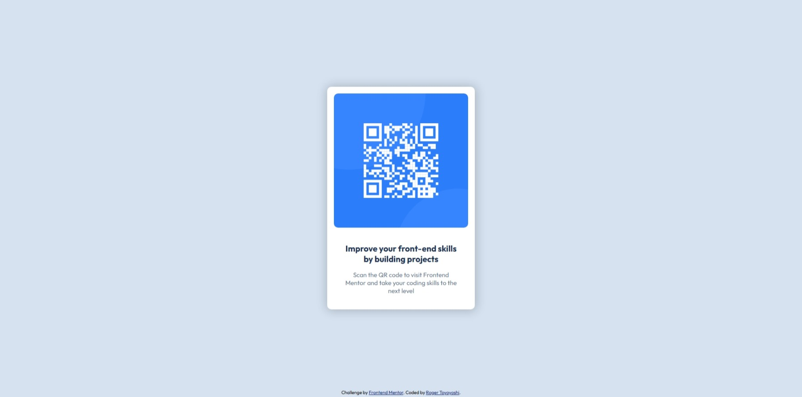

# Frontend Mentor - QR code component solution

This is a solution to the [QR code component challenge on Frontend Mentor](https://www.frontendmentor.io/challenges/qr-code-component-iux_sIO_H). Frontend Mentor challenges help you improve your coding skills by building realistic projects. 

## Table of contents

- [Overview](#overview)
  - [Screenshot](#screenshot)
  - [Links](#links)
- [My process](#my-process)
  - [Built with](#built-with)
  - [What I learned](#what-i-learned)
- [Author](#author)

## Overview

### Screenshot

### Links

- Live Site URL: https://qr-code-component-eight-steel.vercel.app/

## My process

First i have built an HTML structure with the content, then stylized the page with a mobile first approach based on proportions of the figma project.

### Built with

- Semantic HTML5 markup
- CSS custom properties
- Flexbox
- Mobile-first workflow

### What I learned

I have practiced flexbox and media query in the making of this project.

## Author

- Frontend Mentor - [@RogerToyoyoshi](https://www.frontendmentor.io/profile/RogerToyoyoshi)
